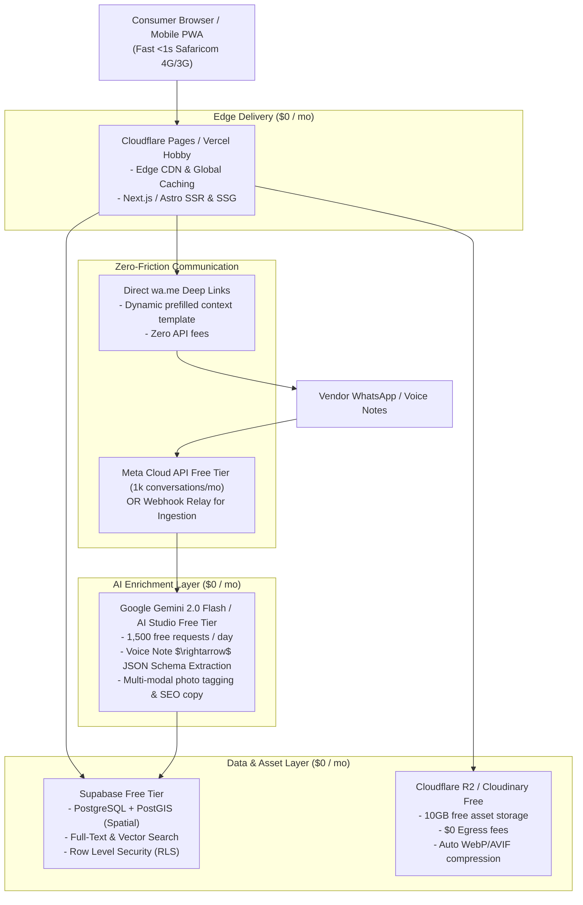
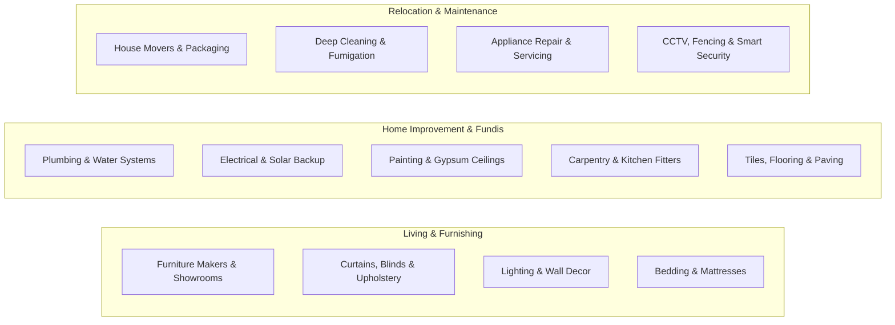

# HOME MARKETPLACE ENGINE — OPERATING SYSTEM & ARCHITECTURE

> **Version:** 1.0.0  
> **Target Market:** Kenya (Nairobi, Kiambu, Machakos, Kajiado metro & national)  
> **Focus Vertical:** Home (Living, Furnishing, Home Improvement, Maintenance, Fundis & Moving)  
> **Infrastructure Cost:** $0.00 / month (Free tier zero-marginal-cost architecture)

---

## 1. Blunt Strategic Critique: What's Right, What's Naive, and The Traps to Avoid

### 1.1 The Brilliant Insights (Keep & Double Down)
1. **Vertical Integration (Products + Services under One Mental Model):**
   - Kenyan consumers do *not* think in categories of "product directories" vs "service apps". When moving into a house in Ruiru or renovating an apartment in Kilimani, they think: *"I need my living room sorted"* (Sofa + Curtains + Painter + Electrician + Mover). Combining them under **Home** solves the actual life transition.
2. **Attribute Graphs over Prose:**
   - Unstructured text classifieds (Jiji, PigiaMe, Facebook Marketplace) are plagued with low-signal fluff: *"Best quality sofa call 07xx..."*. Replacing prose with deterministic, queryable attributes (Kiln-dried hardwood, washable fabric, payment on delivery, warranty duration, parking on-site, 24/7 emergency callout) turns search into a high-confidence **decision engine**.
3. **Programmatic Asset Generation (The 1-to-N Multiplier):**
   - Generating 10+ localized landing pages, SEO collection routes, and shareable WhatsApp cards from one clean record is how you win organic traffic without writing 5,000 manual blog posts.

---

### 1.2 The Naive Assumptions & Fatal Traps (What MUST Change)

| The Naive Assumption | The Reality in Kenya | The World-Class Engineering Fix |
| :--- | :--- | :--- |
| **"Sellers will fill out structured forms"** | Fundis, carpenters on Ngong Road, and duka owners will **drop off after field 3**. Most browse on low-end Androids, use WhatsApp voice notes, and hate web forms. | **Zero-Friction Ingestion:** 1. WhatsApp Audio/Image intake (Whisper + Gemini parses voice note into 50 attributes). 2. Scraping public Instagram/Google Maps & auto-building pre-populated profiles. 3. 3-question conversational WhatsApp onboarding. |
| **"Consumers trust verified badges on screens"** | Kenyans have PTSD from Jiji/Facebook Marketplace scams, fake down payments, and ghost fundis. A generic badge means nothing. | **Kenyan Trust Layer:** 1. Landmark & physical shop GPS verification. 2. Safaricom M-Pesa Till/Paybill verification. 3. Real job before-and-after photo timeline. 4. "Escrow / Pay on Delivery" badges. |
| **"SaaS / Monthly Subscriptions for sellers"** | Kenyan micro-businesses will **not** enter credit cards or commit to recurring debit orders. | **Pay-As-You-Earn Micro-Boosts via M-Pesa STK:** KSh 100–300 per bump, KSh 50 per qualified lead, or KSh 1,500 one-off verification fee triggered via automated phone prompt. |
| **"Western Address Hierarchy (Street + Zip code)"** | Kenyans navigate by **Landmarks & Matatu Stages** (*"Behind Quickmart Kamakis"*, *"Stage ya flyover"*), not street numbers. | **Kenyan Geo-Hierarchy Schema:** `County` $\rightarrow$ `Sub-county` $\rightarrow$ `Estate/Zone` $\rightarrow$ `Landmark Anchor` + GPS coordinates. |
| **"Bigin CRM as the core monetization"** | Most solo fundis won't adopt CRM software in year 1. Relying on CRM affiliate revenue will starve cash flow. | **Platform Monetization First:** Paid spot placements, verified badges, and WhatsApp lead forwarding. Bigin is positioned only for established design firms and showroom studios. |

---

## 2. Zero-Dollar ($0.00) Infrastructure Architecture

The entire ecosystem is engineered to run on generous, production-grade free tiers with **zero monthly cloud bills** until reaching hundreds of thousands of monthly active users:

### The $0 Stack Breakdown:
1. **Hosting & Frontend:** **Next.js 15 (App Router)** or **Astro 5** deployed on **Cloudflare Pages** or **Vercel Hobby**. Edge caching for 99% cache hit ratio on static collection pages.
2. **Database:** **Supabase (PostgreSQL 16)** free tier. Includes PostGIS for radial distance searches (*"Fundis within 5km of Ruiru"*), Full-Text Search in English/Swahili, and JSONB for dynamic attributes.
3. **Media Storage:** **Cloudflare R2** (10GB storage, \$0 bandwidth/egress cost) paired with responsive image optimization.
4. **AI & Vision:** **Google Gemini 2.0 Flash Free Tier** (15 RPM, 1,500 requests/day). Handles image categorization, speech-to-text attribute extraction, and SEO snippet generation.
5. **Vendor Communication:** Zero-cost `https://wa.me/{phone}?text={encoded_intent}` deep links with automated structured pre-fills (e.g., *"Hi John, I saw your 6x6 Mahogany Bed on [Platform] (Ref: #H-2849). Is this available for delivery in Ruiru?"*).

---

## 3. The 3-Pillar Marketplace Engine: HOME Vertical

### The Flywheel of Cross-Discovery:
When a customer searches for **"House Movers in Kilimani"**, the platform automatically suggests:
- **Pre-Move:** Deep Cleaning & Fumigation services in Kilimani.
- **Post-Move:** Wall mounting fundis, curtain fitters, and painters.
- **Furnishing:** Local sofa makers and appliance stores nearby.
Every visit becomes a **multi-lead conversion event**.
