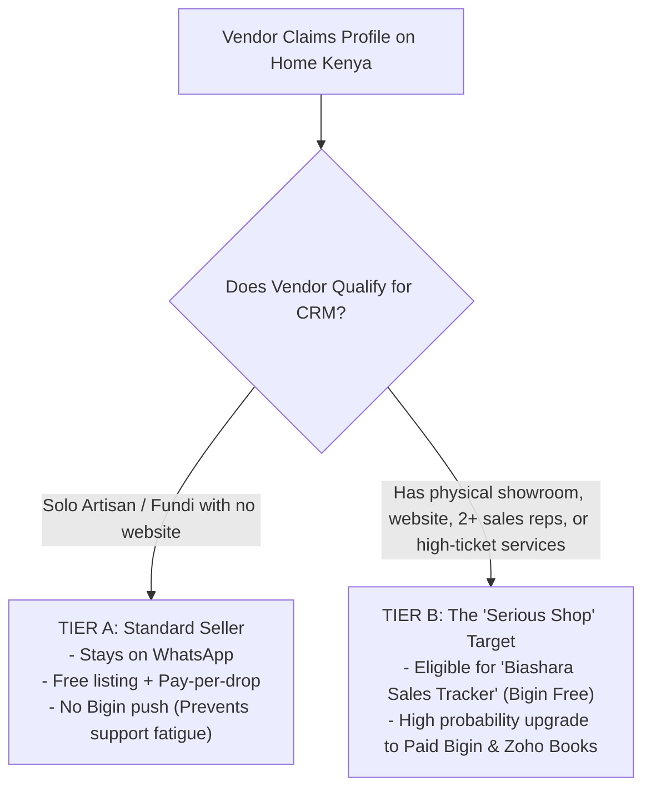

# ZOHO BIGIN PARTNER STRATEGY & THE $5,000 USD REVENUE PLAYBOOK

> **Mission:** Transform tech-aware home businesses and showrooms from free marketplace listings into active Zoho Bigin users, while systematically hitting your **$5,000 USD Zoho Partner annual milestone**.

---

## 1. The Reality of the $5,000 USD Partner Requirement

In the Zoho Partner Program, achieving higher tiers (Authorized Partner / Advanced Partner) requires **$5,000 USD** (approximately **KSh 650,000 – 700,000 KES**) in annual Zoho subscription sales.

### The Fatal Mistake: Trying to Sell $7/Month Licenses to Solo Fundis
- If you sell solo Bigin Express licenses at ~$8/user/month (~$96/year), you need **52 solo accounts** who remember to renew their subscriptions. Solo fundis have high churn and zero software patience.

### The Winning Strategy: Target Serious Shops with Multi-User & Bundle Needs
Focus on businesses that have **3 to 10 employees** and real commercial friction:
- **Furniture Showrooms & Bespoke Workshops** (Mombasa Road, Ngong Road, Kamakis, Parklands).
- **Custom Kitchen & Wardrobe Cabinetry Fitters** (Westlands, Karen, Ruiru).
- **Solar Water Heating & Power Backup Installers** (High ticket: KSh 150k–500k per job).
- **Tile, Granite & Sanitaryware Importers / Distributors**.
- **Professional House Moving Companies**.

**The Math to Hit $5,000 USD:**
$$\text{Option A: 12 Showrooms } \times \text{ 3 Users on Bigin Premier (\$15/mo) } \times 12 \text{ months} = \mathbf{\$6,480 \text{ USD}}$$
$$\text{Option B: 20 Businesses on the "Biashara Growth Suite" Bundle (\$250/yr Zoho component)} = \mathbf{\$5,000 \text{ USD}}$$

You do **not** need 500 customers. You only need **15 to 20 serious businesses** across your verticals.

---

## 2. Who Gets Bigin Free? (The Segmentation Filter)

Do **not** offer Bigin to every seller. Filter ruthlessly:



### The 4 Signs of a "Serious Shop":
1. They already have a **website, registered domain, or professional branding**.
2. They employ more than 1 person to answer calls or manage showroom visits.
3. Their average transaction is over **KSh 30,000** (furniture sets, cabinetry, solar, house moves).
4. They complain: *"We get so many inquiries on WhatsApp that we lose track of who wanted what."*

---

## 3. When & How to Pitch Bigin (The 3 Trigger Points)

> [!WARNING]
> **Never pitch CRM on Day 1.**  
> On Day 1, you promised them free listing and visibility. If you immediately pitch software, you look like a bait-and-switch software salesman.

### Trigger Point 1: The "Lead Follow-Up Pulse" (Day 10–14)
*Wait until their Home Kenya listing generates its first 3 to 5 customer clicks.*

> **Hi [Owner Name],**
> 
> Quick check-in: We noticed homeowners have clicked to view your workshop and contact you on WhatsApp over the past 10 days.
> 
> As your inquiries grow, how are you currently tracking which clients have been given quotes and which ones are ready to pay a deposit?
> 
> Most showroom owners tell us they lose up to 50% of serious buyers simply because older WhatsApp chats get pushed down.
> 
> As a **Home Kenya Verified Partner**, we have a complimentary tool we set up for serious businesses called the **Biashara Sales Tracker (powered by Zoho Bigin)**. It keeps all your WhatsApp inquiries, quotes, and deposits organized on your phone in one clean pipeline.
> 
> It is **100% free** for up to 500 customer records. Would you like us to set up your workshop's sales pipeline board this week?

---

### Trigger Point 2: The "Biashara Professionals Masterclass" Demo
During your bi-weekly live session on Zoho Meeting:
1. **Title:** *"How [Showroom Name] in Ruiru closed KSh 450,000 in custom furniture orders by fixing their WhatsApp follow-up."*
2. **Show the contrast:**
   - *The messy way:* 200 unread WhatsApp chats, sticky notes, forgotten follow-ups.
   - *The Bigin way:* Dragging a deal from **"Quote Sent"** to **"Deposit Received"** on their mobile phone.
3. **The Call to Action:** *"If you want our team to configure this exact pipeline for your business for free, drop a comment or DM us."*

---

### Trigger Point 3: The Natural "Paid Upgrade" Triggers
What makes them upgrade from Bigin Free to Paid ($8–$15/month)?

1. **Multiple Team Members:** The showroom owner hires 2 sales reps and wants all of them answering customer inquiries without fighting over one physical phone. (Requires **Bigin Express/Premier**).
2. **Automated WhatsApp Follow-ups:** Sending automatic payment reminders or delivery status updates via Bigin Message templates.
3. **Zoho Books Integration:** When they need KRA eTIMS compliant invoices, you connect Bigin to **Zoho Books**, generating another compounding partner license!

---

## 4. The Irresistible Offer: "The Biashara Growth Bundle"

Instead of selling software alone, bundle the marketplace power with the software:

```
┌────────────────────────────────────────────────────────┐
│  BIASHARA GROWTH SUITE (For Showrooms & Contractors)   │
├────────────────────────────────────────────────────────┤
│  1. Top Verified Placement on Home Kenya               │
│  2. Two (2) Exclusive WhatsApp Channel Drops / Month   │
│  3. Dedicated 1-Page Mini-Website & Custom Domain      │
│  4. Zoho Bigin CRM Setup + Pipeline Customization      │
│  5. 1-on-1 WhatsApp Follow-Up Sales Training           │
│                                                        │
│  Price: KSh 3,500 / month  OR  KSh 35,000 / year       │
└────────────────────────────────────────────────────────┘
```

### Why this closes easily:
A furniture showroom owner thinks:
*"If this gets me just ONE extra 7-seater sofa sale (KSh 50,000), it pays for the entire year's bundle."*

And on the backend:
- KSh 12,000 of the annual fee covers their Zoho Bigin Premier partner license (credited directly toward your **$5,000 USD partner milestone**).
- KSh 23,000 is pure marketplace margin for your company.
- **Selling just 20 bundles hits your $5,000 USD Zoho Partner target with 100% predictability.**
