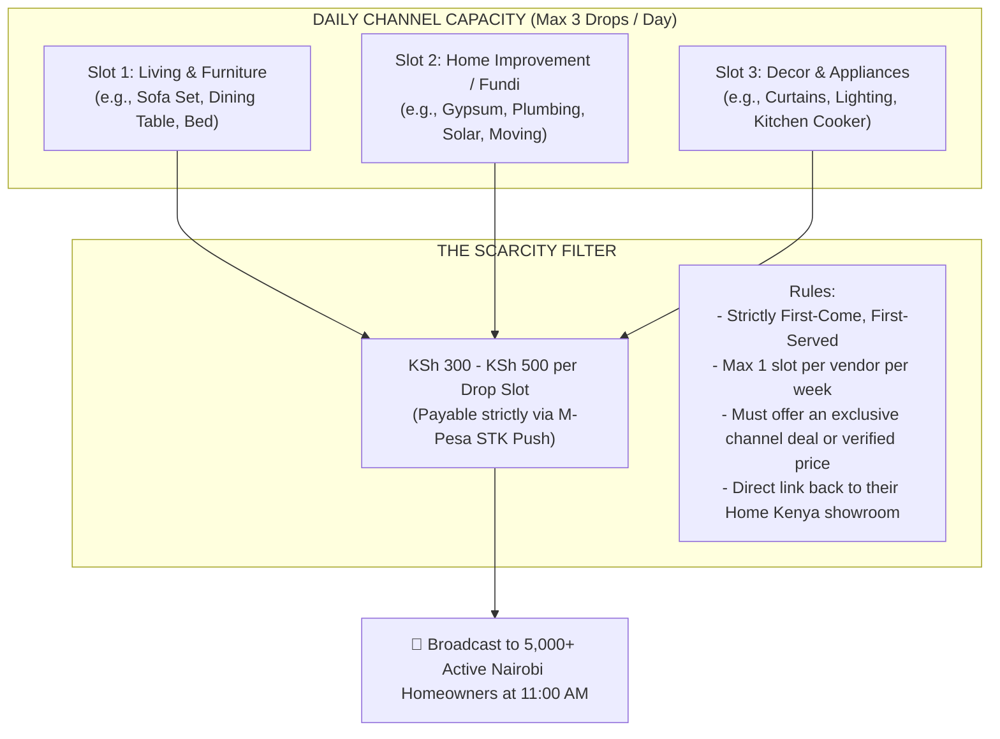

# THE SCARCITY-DRIVEN WHATSAPP CHANNEL MONETIZATION ENGINE

> **Core Philosophy:** A broadcast channel with 2,000–10,000 engaged Kenyan homeowners is more valuable than a Facebook ad.  
> But if you post 30 products a day, consumers will mute it.  
> By strictly capping inventory to **2 to 3 products per day on a first-come, first-served basis**, you create intense vendor demand, prevent consumer fatigue, and build a high-margin recurring cash engine.

---

## 1. The Scarcity Architecture: The "Drop of the Day"

---

## 2. Why This Works Perfectly in Kenya

1. **Eliminates Vendor Fights & Spam:**
   - When slots are free, 200 vendors beg to be featured.
   - When a slot costs **KSh 300 – KSh 500**, it creates a natural quality barrier. Solo fundis with no stock won't pay; established workshops with a KSh 15,000 profit margin on a sofa set will pay immediately.
2. **Guaranteed Visibility for the Paying Vendor:**
   - Because only 1 furniture piece is featured that day, the paying vendor gets **100% of the channel's attention** for their category. There is zero competing noise.
3. **Consumers Love the Signal-to-Noise Ratio:**
   - Homeowners stay subscribed because they only receive **one clean, beautiful drop at 11:00 AM or 4:00 PM**, not 40 spam forwards. Every post feels like an exclusive, curated "Deal of the Day."

---

## 3. The Math: Channel Revenue Projections

| Active Channel Subscribers | Slots per Day | Price per Slot | Daily Revenue | Monthly Revenue |
| :--- | :--- | :--- | :--- | :--- |
| **1,000 – 3,000** | 2 | KSh 300 | KSh 600 | **KSh 18,000 / mo** |
| **3,000 – 7,500** | 3 | KSh 500 | KSh 1,500 | **KSh 45,000 / mo** |
| **10,000+** | 3 + Weekend Special | KSh 750 – KSh 1,000 | KSh 2,500 | **KSh 75,000 – KSh 100,000 / mo** |

*Note: This revenue is 100% automated M-Pesa cash, independent of website ad networks or Google AdSense.*

---

## 4. The Broadcast Template (What the Consumer Sees)

Every drop follows a structured, high-converting format:

> 🛋️ **HOME KENYA DROP OF THE DAY | FURNITURE**  
> 
> **Handcrafted 7-Seater Chesterfield Sofa (Velvet/Waterproof)**  
> 📍 **Workshop:** Classic Hardwood & Interiors — Ruiru (Kamakis)  
> 
> • **Standard Showroom Price:** ~KSh 55,000~  
> • **Exclusive Channel Price:** **KSh 44,500** (Save KSh 10,500)  
> • **Delivery:** Free delivery within Nairobi & Kiambu  
> • **Warranty:** 2-Year written frame guarantee  
> • **Availability:** Only 2 sets available at this price  
> 
> 👉 **View full workshop photos & order directly on WhatsApp:**  
> [https://homekenya.co.ke/p/chesterfield-7seater-kamakis-drop]  
> 
> *(Verified Partner: Physical workshop inspected & M-Pesa Till verified)*

---

## 5. How Vendors Book Slots (Zero Manual Coordination)

On Wednesday afternoon at 3:00 PM, an automated broadcast goes out to all verified sellers in the **Biashara Professionals B2B Channel**:

> *"📢 **Friday & Saturday Drop Slots Open:**  
> We are featuring only 2 furniture makers and 1 home service provider this weekend in the Home Kenya Consumer Channel (5,400+ active homeowners).  
> Slots are KSh 500 on a first-come, first-served basis.  
> 👉 [Tap here to book your slot via M-Pesa]"*

The vendor taps the link $\rightarrow$ enters their product URL $\rightarrow$ M-Pesa prompt triggers $\rightarrow$ Slot is booked and scheduled automatically.
