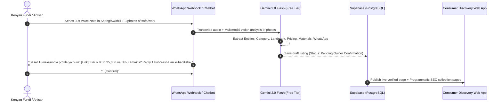

# ZERO-FRICTION SELLER INGESTION & AI ENRICHMENT PIPELINE

> **The Iron Rule:** "If a Kenyan fundi or furniture maker has to fill out a 20-field web form on their phone, the marketplace is dead on arrival."

---

## 1. The Multi-Channel Zero-Touch Intake Architecture



---

## 2. The Three Frictionless Ingestion Vectors

### Vector A: WhatsApp Audio / Photo Voice Note ("The 30-Second Fundi Flow")
- **How it works:**
  - Fundi saves the platform's WhatsApp number.
  - A friendly prompt says:
    > *"Karibu! Ili upate wateja wa Home & Furniture bila malipo, record voice note fupi ukisema: 1) Jina la biashara yako 2) Mahali ulipo (karibu na landmark gani) 3) Kazi au bidhaa unazouza na bei ya kuanzia. Kisha tuma picha 3 za kazi yako."*
  - **AI Extraction Pipeline (Gemini 2.0 Flash):**
    - Accepts multi-lingual audio (Swahili, Kenyan English, Sheng).
    - Extracts:
      - `business_name`
      - `county`, `sub_county`, `neighborhood`, `landmark`
      - `categories`, `subcategories`
      - `price_starting_kes`
      - `accepts_cash_on_delivery` (flagged from context)
    - Computer Vision classifies photos (e.g., checks if photos are real furniture workshops, confirms hardwood vs MDF, generates auto-tags).

### Vector B: Conversational WhatsApp 3-Question Chatbot
For vendors who prefer texting:
1. **Question 1:** *"Jina la biashara na mtaa ulipo? (Mfano: Kamakis Furniture, karibu na Shell Eastern Bypass)"*
2. **Question 2:** *"Kazi kuu unazofanya na bei ya kuanzia? (Mfano: Sofa sets kutoka KSh 32k, Vitanda kutoka KSh 18k)"*
3. **Question 3:** *"Tuma picha 3 hadi 5 za kazi ulizofanya hivi karibuni."*
- **Result:** Complete structured JSON profile generated automatically in < 15 seconds.

### Vector C: Proactive Social Pre-Seeding ("The Claim-Your-Profile Engine")
- Crawling public Kenyan Instagram/TikTok accounts selling furniture, decor, and fundi services in Nairobi/Kiambu.
- Extracting bio, location highlights, and photos.
- Building a **"Shadow Listing"** marked as `unclaimed`.
- When the business is discovered, a single-tap button on their page says:
  > *"Are you the owner of Classic Wood Kamakis? Claim this profile on WhatsApp to receive customer leads directly."*
- One WhatsApp message confirms ownership via phone match.

---

## 3. Natural Language to Attribute Graph: The System Prompt

When raw text or audio transcript arrives from a Kenyan seller, it runs through the following deterministic prompt:

```json
{
  "role": "system",
  "instructions": "You are the data extraction engine for a Kenyan Home & Living marketplace. Extract structured attributes from raw seller inputs (which may be in English, Swahili, or Sheng). Normalize Kenyan geography (e.g. Kamakis -> Kiambu / Ruiru / Kamakis; Syokimau -> Machakos / Mavoko / Syokimau). Detect landmarks, payment terms, hardwood types, delivery terms, and fundi guarantees. Return strict JSON matching the Kenyan BusinessProfile schema."
}
```

---

## 4. Kenyan Trust Verification (How to Eliminate Marketplace Scams)

Scams destroy classified sites in Kenya. To create a 10x superior platform:

1. **Landmark Geo-Triangulation:**
   - Vendor must provide a recognizable physical anchor (e.g., *"Opposite Naivas Kilimani"*, *"Beside Total Kamakis"*).
   - In urban Kenya, genuine businesses exist near verifiable landmarks.
2. **Lipa na M-Pesa Till Verification:**
   - Safaricom registers "Buy Goods" tills against valid national IDs/business permits.
   - Vendors who submit a valid M-Pesa Till number get an instant **"M-Pesa Verified Business"** badge.
3. **Reverse Image Search & Deduplication:**
   - AI checks submitted furniture/job photos against Pinterest, Alibaba, and competitor sites to weed out fake catalogue images.
   - Genuine workshop photos (with background tools, saw dust, Kenyan socket outlets, daylight) receive high trust scores.
4. **Transparent "Pay on Delivery" Badging:**
   - Products and services with Cash/M-Pesa on Delivery are tagged prominently: *"Lipa Baada ya Kazi / Delivery"* — the #1 trust driver for Kenyan buyers.
