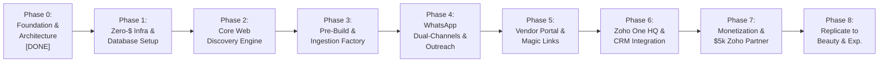

# HOME DIGITAL MARKETPLACE: MASTER EXECUTION PLAN

> **Objective:** Build, deploy, and scale Kenya's premier niche discovery marketplace (*Home Kenya*) with zero monthly infrastructure cost, automated zero-friction onboarding, high-trust monetization, and a clear bridge to the $5,000 USD Zoho Partner milestone.  
> **Status:** Active Execution  
> **Last Updated:** 2026-10-06  

---

## 🧭 Master Roadmap Overview

---

## 📋 Phase-by-Phase Checklist & Acceptance Criteria

### Phase 0: Foundations & Schemas ✅ (COMPLETED)
- [x] **M01–M05 Schemas Defined:** Complete TypeScript schemas in `src/types/schema.ts` for `BusinessProfile`, `KenyanLocation`, `HomeProduct`, `HomeService`, and `BusinessAttributes`.
- [x] **Architectural Blueprint:** System topology and critique documented in `docs/ARCHITECTURE.md`.
- [x] **Zero-Friction Ingestion Blueprint:** Documented in `docs/INGESTION_PIPELINE.md`.
- [x] **Monetization Mechanics:** M-Pesa micro-boosts and badges documented in `docs/MONETIZATION_AND_GROWTH.md`.
- [x] **English Outreach Playbook:** Standardized scripts in `docs/WHATSAPP_OUTREACH_AND_ONBOARDING_PLAYBOOK.md`.
- [x] **Pre-Build & Claim Engine:** Playbook and psychology in `docs/PRE_BUILD_AND_CLAIM_PLAYBOOK.md`.
- [x] **Vendor Lifecycle & Portal Specs:** Documented in `docs/VENDOR_PRODUCT_LIFECYCLE.md`.
- [x] **Dual WhatsApp Channels:** Architecture in `docs/WHATSAPP_CHANNEL_ECOSYSTEM.md`.
- [x] **Scarcity Drops Engine:** Documented in `docs/CHANNEL_MONETIZATION_DROPS.md`.
- [x] **Zoho One & Bigin $5k Strategy:** Complete blueprint in `docs/BIGIN_PARTNER_STRATEGY_AND_PLAYBOOK.md` and `docs/ZOHO_ONE_AND_COMMUNITY_ARCHITECTURE.md`.

---

### Phase 1: Zero-Dollar Infrastructure & Database Setup 🏗️
*Deliverable: Fully connected, production-ready cloud database and edge hosting running at $0.00/mo.*
- [ ] **1.1 Next.js 15 / Astro 5 Project Scaffold:** Set up in the current repository with Tailwind CSS, TypeScript, and mobile-first responsive layout.
- [ ] **1.2 Supabase PostgreSQL Setup:**
  - Create Supabase project (Free Tier).
  - Enable **PostGIS** extension for spatial landmark queries.
  - Run database migration scripts for tables: `businesses`, `locations`, `products`, `services`, `leads`.
- [ ] **1.3 Cloudflare R2 / Asset Storage:**
  - Set up Cloudflare R2 bucket for product/workshop images (10GB free, $0 egress).
  - Configure responsive image optimization (WebP/AVIF).
- [ ] **1.4 Google Gemini 2.0 Flash API Integration:**
  - Configure free Google AI Studio API key in `.env.local` for zero-cost multi-modal vision and Swahili/English text extraction.
- [ ] **1.5 Edge Deployment:**
  - Connect Git repository to Cloudflare Pages or Vercel Hobby for automated CI/CD deployments.

---

### Phase 2: Core Web Discovery Engine (Consumer Frontend) 🛋️
*Deliverable: Ultra-fast (<1s load time) consumer web experience optimized for Kenyan mobile devices.*
- [ ] **2.1 Homepage & Kenyan Mental Geography Search:**
  - Hero search bar allowing queries like: *"Hardwood beds in Ruiru"*, *"Plumbers in Kilimani"*, *"Gypsum painters near Kamakis"*.
  - Neighborhood & Sub-county quick-filter pills (Nairobi Metro: Westlands, Kilimani, Ruiru, Kamakis, Rongai, Syokimau).
  - Category quick-cards (Living Room, Bedroom, Plumbing, Electrical & Solar, House Moving, Interior Decor).
- [ ] **2.2 Business Showroom / Decision Page (`/biz/[slug]`):**
  - High-impact visual gallery (workshop photos + product cards).
  - Trust bar: Physical Landmark anchor (*"Behind Quickmart Kamakis"*), M-Pesa Buy Goods Till badge, "Pay on Delivery" badge, 2-Year Warranty badge.
  - Structured attributes checklist (Parking, Solid Mahogany, Epra Certified, Same-Day Delivery).
  - Prominent sticky floating button: **"Chat on WhatsApp"** with prefilled product context.
- [ ] **2.3 Product / Service Detail Page (`/p/[slug]`):**
  - Large responsive image carousel.
  - Transparent price tag (KES) + in-stock / made-to-order lead time.
  - Direct WhatsApp order button with SKU/Ref tracking.
- [ ] **2.4 Programmatic Collection Pages (`/[category]-in-[neighborhood]`):**
  - Dynamic SEO routes (e.g. `/sofa-makers-in-ruiru-kamakis`, `/emergency-plumbers-in-kilimani`).
  - Automated Schema.org `LocalBusiness` JSON-LD for instant Google rich snippets.
  - Dynamic FAQ section tailored to the neighborhood.

---

### Phase 3: The Pre-Build & Ingestion Factory ⚙️
*Deliverable: Automated pipeline that turns an Instagram link, Facebook post, or WhatsApp catalog into a live showroom in < 60 seconds.*
- [ ] **3.1 Raw Input Ingestion Script:**
  - Accepts a social media URL, text dump, or image set.
  - Extracts business bio, landmark, products, and prices via Gemini 2.0 Flash.
- [ ] **3.2 Database Seed & Pre-Build Generator:**
  - Inserts listing into Supabase with `is_claimed = false`.
  - Generates the live preview URL: `homekenya.co.ke/biz/[slug]`.
- [ ] **3.3 Automated Outreach Message Formatter:**
  - Generates the personalized pre-build WhatsApp copy ready to be sent to the business owner with one click.
- [ ] **3.4 Pilot Batch (Seed 30 Businesses):**
  - Pre-build 15 furniture makers in Ruiru/Kamakis/Ngong Road.
  - Pre-build 10 verified emergency plumbers & electricians in Kilimani/Westlands.
  - Pre-build 5 professional moving companies.

---

### Phase 4: WhatsApp Dual-Channel Launch & Outreach Campaign 📢
*Deliverable: 30 claimed vendors onboarded; B2B and B2C channels initialized.*
- [ ] **4.1 Launch Channel 1 (B2B): Biashara Professionals:**
  - Set up WhatsApp Announcement Channel with 1-way broadcast and threaded comments.
  - Prepare first 5 daily micro-tips (taking better lighting photos, reviving dead WhatsApp inquiries).
- [ ] **4.2 Launch Channel 2 (B2C): Home Kenya Deals & Living:**
  - Set up consumer broadcast channel.
  - Add subscription buttons on the platform homepage and product pages.
- [ ] **4.3 Execute Outreach Batch (30 Pre-Built Vendors):**
  - Dispatch the "Pre-Build & Claim" message to the 30 pilot businesses.
  - Target: **18+ Claimed listings (60%+ conversion rate)**.
  - Invite all claimed vendors into the Biashara Professionals channel.

---

### Phase 5: Self-Service Vendor Lifecycle (Magic Link & Bot) 📱
*Deliverable: Zero-password vendor management allowing instant product additions and out-of-stock toggles.*
- [ ] **5.1 Tokenized Magic-Link Mobile Portal (`/portal/[vendor-token]`):**
  - Passwordless mobile UI displaying active products.
  - Simple Green/Gray toggle: `[In Stock / Sold Out]`.
  - Delete button.
- [ ] **5.2 "Add Product in 3 Fields" Drawer:**
  - Fields: 1) Photo upload, 2) Title, 3) Price (KES).
  - Background AI pipeline: Auto-generates description, tags, room category, and SEO schema in 5 seconds.
- [ ] **5.3 Instant WhatsApp Confirmation Feedback:**
  - Sends immediate WhatsApp message back to the vendor with their live product link and quick text commands (`OUT`, `PRICE`, `DELETE`).

---

### Phase 6: Zoho One Integration & Operational HQ 🏢
*Deliverable: Centralized operations command center inside Zoho One managing multi-platform growth.*
- [ ] **6.1 Zoho CRM Setup:**
  - Add mandatory custom field: `Platform: [Home Kenya, Beauty Kenya, Experiences Kenya]`.
  - Configure Layout Rules for Home Kenya (show workshop landmarks, solid hardwood type, EPRA certification).
  - Set up dedicated Deal Pipelines: `Home Vendor Onboarding`, `Weekend Micro-Boosts`, `Bigin Partner Upgrades`.
- [ ] **6.2 Zoho Flow Webhook Relay:**
  - Connect Supabase database webhooks via `src/utils/zoho_flow_webhook.ts`.
  - Automatically create/update Accounts, Contacts, and Deals in Zoho CRM in real time.
- [ ] **6.3 Zoho Mail & Zoho Desk Multi-Domain Setup:**
  - Verify `homekenya.co.ke` domain in Zoho Mail.
  - Set up `hello@homekenya.co.ke` and create dedicated support department in Zoho Desk.
- [ ] **6.4 Biashara Professionals Masterclasses via Zoho Meeting:**
  - Schedule bi-weekly live session inside Zoho Meeting for vendors.

---

### Phase 7: Monetization Rollout & The $5,000 USD Partner Goal 💰
*Deliverable: Recurring cash flow from M-Pesa micro-boosts, category drops, and hitting the Zoho Partner tier.*
- [ ] **7.1 M-Pesa Daraja API Integration (Micro-Boosts):**
  - Set up Safaricom Daraja STK Push integration.
  - Enable one-tap KSh 250 weekend boost for vendors.
- [ ] **7.2 WhatsApp Consumer Channel "Drop of the Day" (KSh 300 – 500):**
  - Open 2–3 daily category slots on a first-come, first-served basis.
  - Broadcast exclusive channel drops to consumers at 11:00 AM daily.
- [ ] **7.3 Serious Shop CRM Outreach (Day 10–14 Trigger):**
  - Identify top 15 showrooms and high-ticket home businesses with 2+ staff.
  - Execute the "Biashara Sales Tracker (Bigin Free)" pitch.
  - Provision pre-configured Kenyan Home Sales Pipeline boards.
- [ ] **7.4 Close 20 "Biashara Growth Suite" Annual Bundles:**
  - Package: Verified Directory Top Spot + 2 Monthly WhatsApp Drops + Bigin Premier Setup (KSh 35,000/year).
  - **Milestone Reached:** $5,000+ USD in Zoho subscription revenue achieves next-level Partner tier.

---

### Phase 8: Factory Replication (Beauty & Experiences) 🚀
*Deliverable: Clone the tested engine into vertical #2 and #3.*
- [ ] **8.1 Launch Vertical 2: Beauty Kenya (`beautykenya.co.ke`):**
  - Clone database schema and UI components.
  - Target: Salons, barbers, spas, braiding, and cosmetic retailers.
  - Leverage existing B2B seller network in Biashara Professionals.
- [ ] **8.2 Launch Vertical 3: Experiences Kenya (`experienceskenya.co.ke`):**
  - Decision engine for family activities, kid-friendly dining, weekend events, and outdoor experiences.
