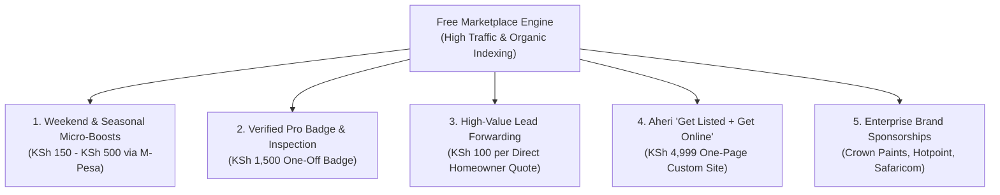

# REVENUE & MONETIZATION ENGINE (KENYAN ECONOMIC REALITY)

> **Core Philosophy:** "Monetize where money naturally flows in Kenya: M-Pesa micro-transactions, pay-per-performance, and high-trust verified visibility. Do NOT impose Western recurring credit card subscriptions on informal artisans."

---

## 1. Why Western SaaS Fails with Kenyan SMEs

| Traditional Western Model | Why It Fails in Kenya | The High-Conversion Kenyan Solution |
| :--- | :--- | :--- |
| **$29/month recurring card charge** | 90%+ of fundis don't have credit cards. Auto-debits cause bank distrust. High churn. | **M-Pesa STK Push Micro-Payments:** Prompt appears directly on vendor's Safaricom SIM screen for PIN. |
| **"Pay before getting any value"** | Fundis suspect scams immediately. They won't pay upfront for unknown digital promises. | **Freemium Indexing + Pay to Accelerate:** Free basic listing, pay only when they see leads or want peak weekend ranking. |
| **Complicated dashboard/portal** | Vendors don't log in to desktop dashboards. | **WhatsApp-Driven Upsell Triggers:** Automated ping: *"28 homeowners viewed your Ruiru listing this week. Want to be #1 this weekend for KSh 200?"* |

---

## 2. The 5 Compounding Revenue Streams

---

### Stream 1: Weekend & Holiday Micro-Boosts (High Volume)
- **When Kenyans Buy Home Goods:** Fridays and Saturdays are peak furniture shopping and moving days in Nairobi/Kiambu.
- **The Pitch:** On Thursday at 4 PM, automated WhatsApp prompt to top sellers:
  > *"Habari John! Wikendi hii kuna wateja 500+ wanatafuta sofa Ruiru na Eastern Bypass. Weka biashara yako namba 1 kwa KSh 250 tu ya M-Pesa kuanzia Ijumaa hadi Jumapili. Bonyeza link au jibu YES kutuma prompt."*
- **Execution:** Vendor taps YES $\rightarrow$ Safaricom STK push pops up on phone $\rightarrow$ Vendor enters PIN $\rightarrow$ System activates boost instantly via Daraja API webhook.
- **Unit Economics:** 200 vendors $\times$ KSh 250 $\times$ 4 weekends = **KSh 200,000 / month** pure automated margin.

---

### Stream 2: "Verified Pro" Trust Certification (One-Off Trust Barrier)
- **Problem:** Unverified vendors get fewer inquiries because consumers fear scams.
- **Solution:** "Verified Pro" badge requires:
  1. Phone verification.
  2. Physical shop/workshop photo verification.
  3. M-Pesa Buy Goods Till confirmation.
- **Pricing:** KSh 1,500 one-off inspection and vetting fee.
- **Value to Seller:** Verified profiles receive **4.8x more direct WhatsApp taps** than unverified listings.

---

### Stream 3: Direct Lead Dispatch (High Ticket Home Services)
- For high-ticket home projects (House moving, Gypsum ceiling, Full interior paint, Solar installation):
  - Homeowner fills a 30-second quote request: *"3-Bedroom Move from Kilimani to Ruiru Membley on 1st November"*.
  - System notifies top 3 verified movers: *"New move request in Kilimani. Pay KSh 150 to unlock customer phone & WhatsApp."*
  - Zero risk for the consumer; high intent lead for the vendor.

---

### Stream 4: Aheri "Get Listed + Get Online" (The Digital Agency Upsell)
- **Target:** Showrooms, interior designers, mid-sized furniture workshops without a website.
- **Offer:**
  - Dedicated one-page custom domain (e.g. `kamakisfurniture.co.ke`).
  - Catalog integrated with the marketplace.
  - WhatsApp CRM setup (Bigin free onboarding).
  - Google Business Profile optimization.
- **Pricing:** KSh 4,999 – KSh 9,999 one-time + KSh 2,500 annual domain & hosting maintenance.

---

### Stream 5: National Home Brand Sponsorships
Once the platform dominates organic search terms like *"Best painters in Nairobi"*, *"Gypsum ceiling price per sqm Kenya"*, *"Hardwood beds Ruiru"*:
- Category sponsorship banners from:
  - **Paint:** Crown Paints, Kansai Plascon, Basco Paints (Duracoat).
  - **Appliances:** Hotpoint, Ramtons, Mika, Samsung Kenya.
  - **Moving & Logistics:** Matatu SACCOs, Lori hire fleets, Safaricom Home Fibre.
