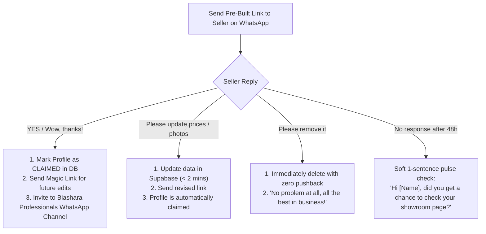

# THE "PRE-BUILD & CLAIM" ACQUISITION ENGINE

> **Core Insight:** Cold outreach asking someone to join requires imagination and effort. Giving someone a finished, live, beautiful showcase of their own business and asking if they want to claim it triggers the **Endowment Effect** and eliminates skepticism.

---

## 1. Why Pre-Building Wins Over Cold Asking

| Cold "Permission" Outreach | The "Pre-Build & Claim" Engine |
| :--- | :--- |
| Seller thinks: *"Who is this? Is it a scam? What work do I have to do?"* | Seller thinks: *"Wow, someone built this for me? My work looks amazing here!"* |
| Requires imagination: They can't visualize what their page will look like. | Tangible reality: They tap a link and see their actual photos, prices, and phone number. |
| Asking for a favor: *"Please send us your catalog."* | Giving an unexpected gift: *"We built this free asset for your business."* |
| Conversion Rate: ~5% – 10% | **Conversion Rate: 45% – 70%** |

---

## 2. The Psychology Behind the "Claim" Flow

1. **The Endowment Effect:** People value things significantly more when they feel they already possess them. By handing them a live URL (`homekenya.co.ke/biz/their-name`), it is already *theirs*. Turning it down feels like losing an asset.
2. **The "Check My Phone" Test:** When the vendor taps the **"Chat on WhatsApp"** button on their preview page, **their own WhatsApp opens**. That instant realization—that a real customer tapping this would land on their phone—creates an immediate "Aha!" moment.
3. **Flattery & Recognition:** *"We saw your impressive furniture on Instagram and featured your workshop"* flatters their craftsmanship and positions your platform as a curator of quality, not a spam directory.

---

## 3. The High-Converting "Pre-Build & Claim" Outreach Script

### The Outreach Message (English):

> **Hi [Owner Name / Business Name],**
> 
> We came across your work on [Instagram / Facebook]—really impressive craftsmanship on your [sofas / beds / plumbing projects]!
> 
> We run **Home Kenya** (`homekenya.co.ke`), a verified discovery platform connecting homeowners and movers across Nairobi and Kiambu directly to quality home suppliers.
> 
> Because of the quality of your work, our team went ahead and created a complimentary digital showroom page for your business:
> 
> 👉 **Take a look here:** [https://homekenya.co.ke/biz/your-business-slug]
> 
> **Here is what we did:**
> 1. We indexed your key products, starting prices, and workshop location ([Landmark/Neighborhood]).
> 2. We wired the direct WhatsApp button to your number (**[07XXXXXXXX]**) so homeowners contact you directly with zero middleman fees.
> 
> **How to claim this page (100% Free):**
> If you like how it looks and want to keep it live to receive customer inquiries, simply reply with **"YES"** to claim it.
> 
> If you'd like to update any prices or add newer photos, just let us know and we’ll update it immediately. *(If you prefer not to be listed, just let us know and we'll remove it right away, no problem at all!)*
> 
> How does the page look to you? 🤝

---

## 4. Handling Seller Responses

### Script for "YES / Looks great!":
> **Awesome, congratulations! 🚀**
> 
> Your page is officially claimed and verified. Homeowners browsing in [Neighborhood/County] can now discover your products directly.
> 
> We’ve also added you to our weekly business tips via the **Biashara Professionals** channel where we share practical ways to convert WhatsApp inquiries into paid clients.
> 
> Whenever you have new items or want to mark anything out of stock, just drop a photo and price here anytime!

### Script for "Update prices / details":
> **On it!** Send over the updated prices or new photos right here, and our team will adjust your page within minutes.

### Script for "Please remove it" (Very rare, < 2%):
> **Understood, [Name]!** We have completely removed the page. Thank you for your time, and we wish your business continued success!

---

## 5. Automation Workflow: Pre-Building at Scale

How you pre-build 50 profiles in a weekend without getting exhausted:

1. **Scouting (Input):** Your team identifies 20 active furniture/home advertisers on Instagram/Facebook.
2. **Ingestion (AI):** Paste the social handle into your scraper/Gemini Flash extraction pipeline. It pulls:
   - Bio $\rightarrow$ Description & Tagline
   - Posts $\rightarrow$ 3–5 clean product images + captions $\rightarrow$ Titles & Prices
   - Bio Link/Phone $\rightarrow$ WhatsApp number & Landmark
3. **Database Write:** Generates draft listing with `is_claimed = false`.
4. **Outreach Dispatch:** Automated or semi-automated personalized WhatsApp message sent to the seller with the live preview link.
