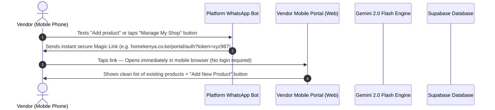
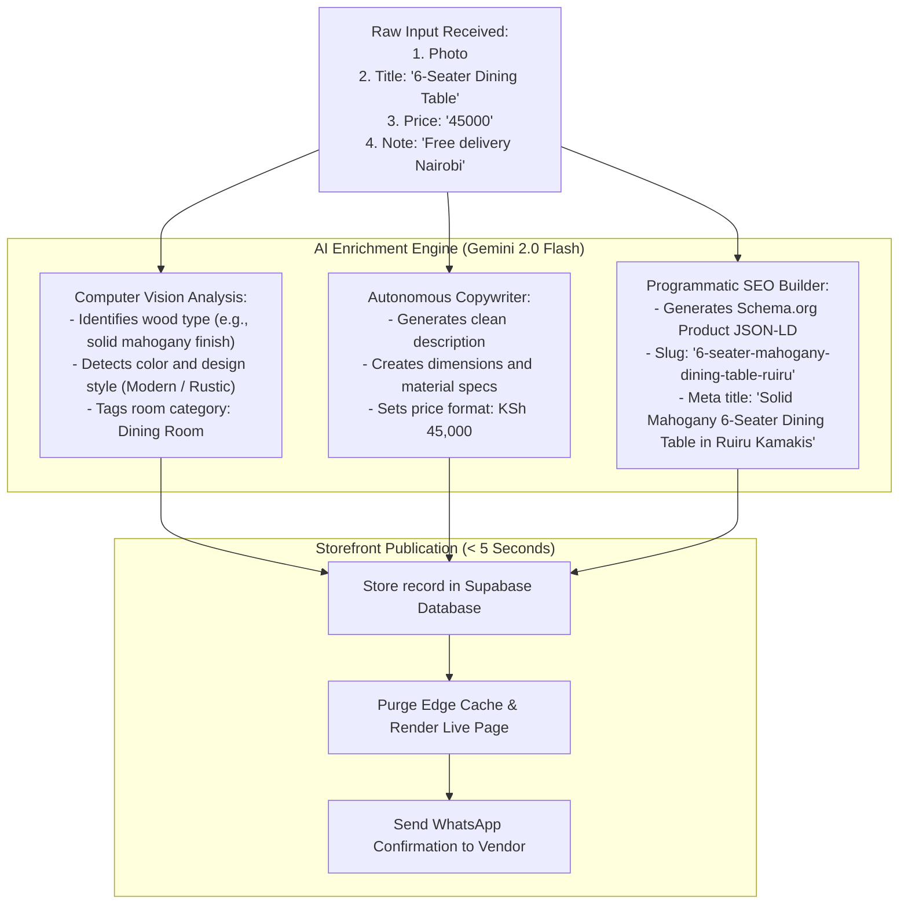

# VENDOR PRODUCT LIFECYCLE: THE SELF-SERVICE PORTAL & WHATSAPP ENGINE

> **The Problem We Solve:** Traditional seller portals demand usernames, 12-character passwords, complex category trees, and 15 form fields per item. 95% of Kenyan artisans give up immediately.  
> **Our Solution:** A **zero-password mobile web portal** and a **WhatsApp drop-bot** where adding a product takes under 20 seconds.

---

## 1. How the Vendor Accesses the Portal (Zero Passwords)

Instead of forcing the seller to register with an email and password:



### Why Magic Links Win in Kenya:
- **No passwords to forget:** The WhatsApp phone number is their identity anchor.
- **Tokens are secure:** The magic link has a 14-day rolling expiry and is sent only to their verified WhatsApp number.
- **Works on any smartphone:** Opens directly in Chrome/Safari on low-to-mid range Android devices.

---

## 2. Step-by-Step UI/UX: What the Vendor Sees on Their Screen

When the vendor taps their magic link, they see an uncluttered, single-screen mobile interface:

```
┌───────────────────────────────────────────────┐
│  Home Kenya  |  Classic Hardwood Kamakis ⚙️   │
├───────────────────────────────────────────────┤
│  YOUR LIVE SHOWROOM (3 Active Products)       │
│                                               │
│  [+] ADD NEW PRODUCT                          │
│                                               │
│  ┌─────────────────────────────────────────┐  │
│  │ 📷 [Sofa Photo]   Chesterfield 7-Seater  │  │
│  │ Price: KSh 55,000                        │  │
│  │ Status: 🟢 IN STOCK   [Toggle: Out/In]   │  │
│  │ [🗑️ Delete]                             │  │
│  └─────────────────────────────────────────┘  │
│                                               │
│  ┌─────────────────────────────────────────┐  │
│  │ 📷 [Bed Photo]    Mahogany 6x6 Storage   │  │
│  │ Price: KSh 38,000                        │  │
│  │ Status: 🔴 OUT OF STOCK [Toggle]         │  │
│  │ [🗑️ Delete]                             │  │
│  └─────────────────────────────────────────┘  │
└───────────────────────────────────────────────┘
```

---

## 3. Adding a New Product in 3 Quick Fields

When the vendor taps **"[+] ADD NEW PRODUCT"**, a clean slide-up drawer appears with only **three fields**:

```
┌───────────────────────────────────────────────┐
│  Add a New Product                            │
├───────────────────────────────────────────────┤
│                                               │
│  1. Product Photo:                            │
│     [ 📸 Tap to Snap or Upload Photo ]       │
│                                               │
│  2. Product Title / What is it?               │
│     [ e.g., 6-Seater Dining Table & Chairs  ] │
│                                               │
│  3. Price (KSh):                              │
│     [ e.g., 45000                           ] │
│                                               │
│  Optional Note (Audio or Text):               │
│     [ e.g., Free delivery within Nairobi    ] │
│                                               │
│  [ 🚀 PUBLISH PRODUCT ]                       │
└───────────────────────────────────────────────┘
```

### That's all the vendor fills!
No technical specifications, no SEO tags, no category trees, no markdown.

---

## 4. What Happens in the Background (The AI Enrichment Factory)

The moment the vendor taps **"[ 🚀 PUBLISH PRODUCT ]"**, the automation takes over:



---

## 5. The Instant Feedback Loop (WhatsApp Delivery)

Within 5 to 10 seconds of tapping Publish, the vendor receives an automated message on their WhatsApp:

> **✅ Your product is now live!**  
> 
> **Item:** Solid Mahogany 6-Seater Dining Table  
> **Price:** KSh 45,000 (Free Nairobi Delivery)  
> 
> 🔗 **View live product page:**  
> `https://homekenya.co.ke/p/6-seater-mahogany-dining-table-ruiru`  
> 
> *To mark as sold out anytime, toggle the button in your portal or simply reply `OUT dining-45k` right here on WhatsApp.*

---

## 6. How Out-of-Stock and Removal Work

1. **Mark Out-of-Stock:**
   - In the portal: Vendor taps the toggle from `🟢 IN STOCK` to `🔴 OUT OF STOCK`.
   - On WhatsApp: Vendor replies `OUT [product-code]`.
   - *Result on the live site:* The item displays an "Out of Stock / Sold Out" badge. The inquiry button is grayed out, but the page remains indexed by Google to preserve SEO search authority.
2. **Deleting / Stopping Sale:**
   - In the portal: Vendor taps `[🗑️ Delete]`.
   - On WhatsApp: Vendor replies `DELETE [product-code]`.
   - *Result:* The item is immediately removed from the vendor's storefront and category search results.
