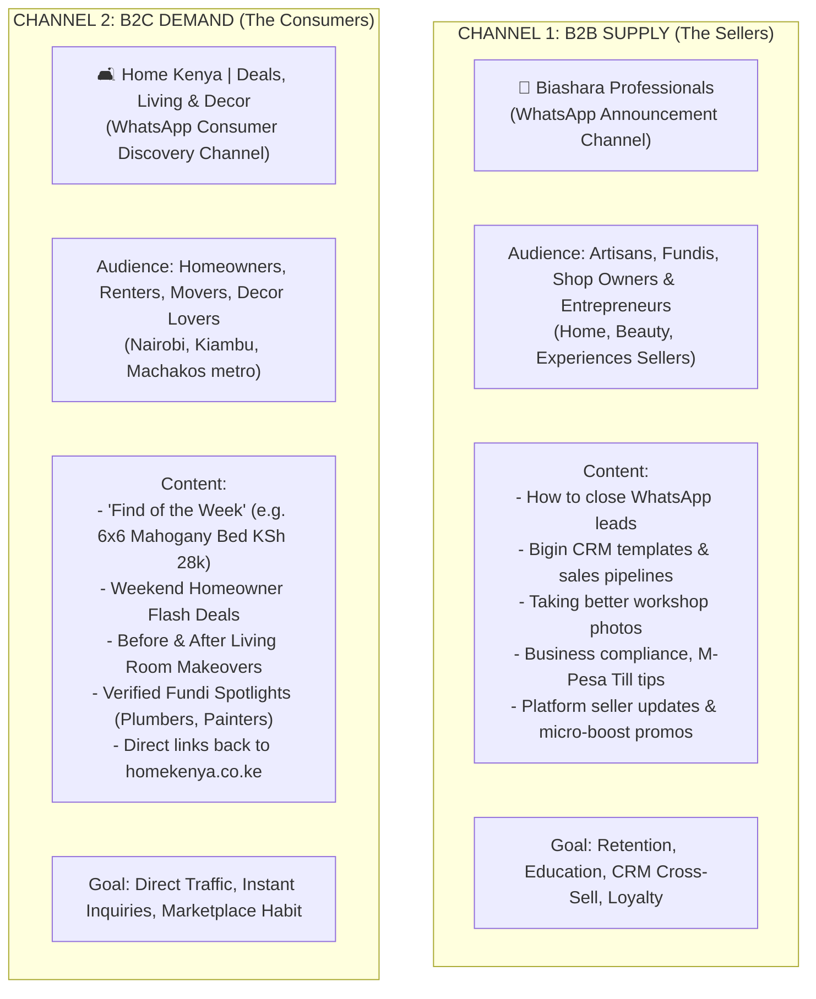
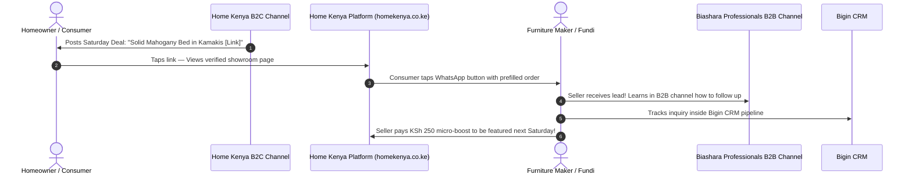

# THE WHATSAPP CHANNEL ECOSYSTEM: B2B VS. B2C DUAL ARCHITECTURE

> **The Golden Rule of Community Segmentation:**  
> Never mix sellers and consumers in the same broadcast channel.  
> Sellers want **leads, pricing power, and business growth**. Consumers want **inspiration, deals, and reliable solutions**.  
> Mixing them leads to instant mutes, unfollows, and audience confusion.

---

## 1. The Two-Channel Architecture

---

## 2. Channel 1: Biashara Professionals (B2B Engine)

### Who Belongs Here?
- Every seller onboarded from **Home Kenya**.
- Future sellers from **Beauty Kenya** and **Experiences Kenya**.
- General Kenyan entrepreneurs, tradespeople, and SME operators.

### Why this is your Long-Term Strategic Moat:
1. **Unified Seller Network:** When you launch *Beauty Kenya* or *Experiences Kenya*, you do not start from zero. Your supply side already trusts the Biashara Professionals brand!
2. **The Education & Bigin Funnel:** This is where you nurture them from informal fundis into structured businesses using Bigin CRM and Zoho One business tools.
3. **Zero Platform Clutter:** Sellers are not distracted by random retail product posts. They receive actionable, bite-sized business acumen.

### Sample B2B Weekly Content Calendar:
- **Monday:** *Sales Tip:* "The 1 follow-up text that revives 40% of dead WhatsApp inquiries."
- **Wednesday:** *Operations:* "Why switching from 'Send Money' to an M-Pesa Buy Goods Till increases consumer trust by 300%."
- **Friday:** *Weekend Prep:* "How to prepare your quotes and inventory for weekend furniture shoppers."

---

## 3. Channel 2: Home Kenya | Deals & Living (B2C Engine)

### Who Belongs Here?
- Homeowners, apartment renters in Kilimani, Ruiru, Westlands, Syokimau, etc.
- People planning house moves, renovations, or wedding/new home furnishing.
- Consumers who discover your website and tap *"Join our WhatsApp for weekly home deals"*.

### Why a Dedicated Consumer Product Channel is a Traffic Monster in Kenya:
- **Kenyans Live on WhatsApp:** Consumers check WhatsApp Channels far more consistently than opening promotional emails or browsing websites daily.
- **The "Drop" Psychology:** When you broadcast an exclusive deal (e.g. *"Weekend Flash: 7-Seater Chesterfield in Kamakis down from KSh 55k to KSh 44k — Only 2 sets available [Link]"*), it creates immediate urgency and sends a surge of traffic to the vendor's page.
- **Monetization Engine (The Boost Value):** When a vendor pays KSh 250 for a "Weekend Micro-Boost", part of their reward is being featured in the **Home Kenya Consumer Channel**! This gives paying sellers immediate, tangible eyeballs.

### Sample B2C Weekly Content Calendar:
- **Tuesday:** *Home Inspiration:* "Before & After: How a Ruaka 2-bedroom was transformed with gypsum lighting & modern curtain blinds [View fundis involved]."
- **Thursday:** *Verified Fundi Spotlight:* "Emergency plumbing guide: 3 certified plumbers in Kilimani and Kileleshwa available 24/7 [View profiles]."
- **Saturday Morning:** *Weekend Showcase:* "Top 5 Solid Hardwood Beds under KSh 35,000 available for immediate delivery in Nairobi [Browse catalogue]."

---

## 4. How the Ecosystem Feeds Itself (The Flywheel)

---

## 5. Summary Recommendation

1. **Invite All Sellers into Biashara Professionals:** As soon as a vendor claims their profile, send them the link to the Biashara Professionals channel:
   > *"We’ve also added you to our weekly business tips channel on Biashara Professionals where we share practical ways to convert WhatsApp inquiries into paid clients."*
2. **Create the Consumer Channel for Home Kenya:** Launch `Home Kenya | Deals & Living` as the dedicated public discovery channel. Put a prominent button on the homepage and every product page:
   > *"🔔 Join 1,500+ homeowners on WhatsApp for weekly furniture deals & trusted fundi alerts."*
