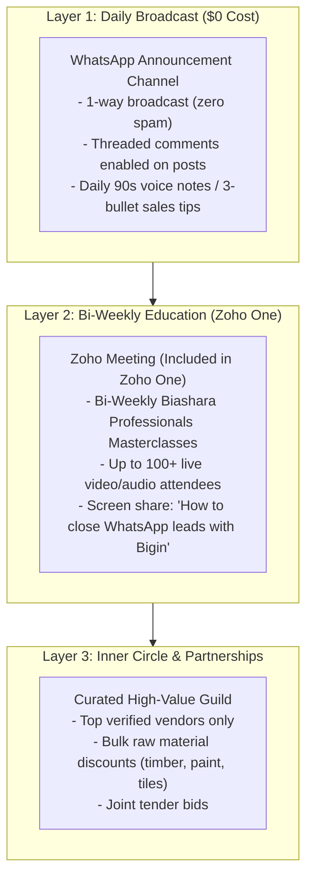
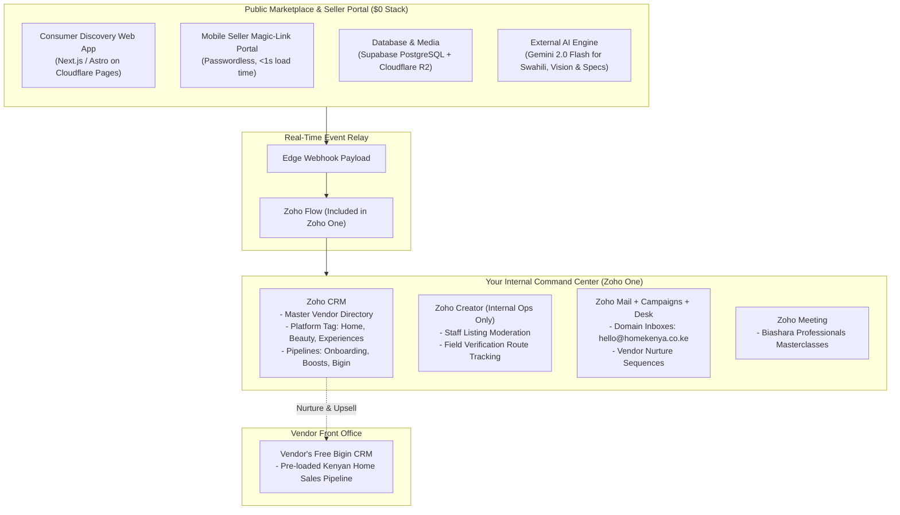

# ZOHO ONE MULTI-PLATFORM & COMMUNITY ARCHITECTURE

> **Executive Summary:** How to leverage your **Zoho One** suite as an automated operational HQ without running into unexpected licensing fees, vendor adoption fatigue, or technical bloat.

---

## 1. Deep-Dive: Zoho Connect Licensing & Community Reality

### Is Zoho Connect included in Zoho One?
- **Internal Network:** **YES.** Zoho Connect's internal team collaboration network is included in Zoho One for your licensed employees.
- **External Users:** Within your internal network, you are typically limited to **only 5 external guests per 1 paid Zoho One license**.
- **External Networks (for large client/vendor communities):** **NO.** Large external networks are **not included** in the base Zoho One bundle. They require separate paid subscriptions or a transition to **Zoho CommunitySpaces**.

### Why Zoho Connect is a Trap for Kenyan Vendors:
1. **Licensing Shock:** If you onboard 500 vendors to an external Zoho Connect network, you will be hit with hefty per-user or external-community fees.
2. **Adoption Friction:** Kenyan fundis and shop owners will **not** download the Zoho Connect mobile app, create a Zoho account, and remember a login password. They will abandon it within 24 hours.

### The Winning Community Model ($0 Cost, 100% Reach):
Instead of forcing vendors onto a separate app, use channels they already use every single hour:

---

## 2. Where Do Zoho Creator, Catalyst, and Zia Fit In?

Zoho One provides over 45 applications, but using the wrong tool in the wrong place causes **developer fatigue and licensing traps**. Here is the razor-sharp map:

| Zoho Product | Included in Zoho One? | Where to Use It | Where NOT to Use It |
| :--- | :--- | :--- | :--- |
| **Zoho CRM** | **YES** (Enterprise) | **Master Vendor HQ:** Central record of all businesses across Home, Beauty, and Experiences with platform tags. | Do not expose directly to public consumers. |
| **Zoho Flow** | **YES** | **The Integration Glue:** Automatically listens to webhooks from your web database and syncs CRM, Campaigns, and Desk. | Do not use for high-frequency millisecond consumer requests. |
| **Zoho Meeting** | **YES** | **Biashara Professionals Masterclasses:** Live video/audio workshops for vendors. | N/A |
| **Zoho Campaigns** | **YES** | **Drip Email Sequences:** Onboarding emails, weekly business summaries, and tips. | Do not use for transactional OTPs or instant alerts. |
| **Zoho Desk** | **YES** | **Multi-Department Support:** Ticket routing for `homekenya.co.ke` vs `beautykenya.co.ke`. | N/A |
| **Zia AI** | **YES** (Inside CRM) | **Internal Intelligence:** Lead scoring, best time to contact vendors, and anomaly detection. | Cannot parse Swahili/Sheng voice notes or WhatsApp images. |
| **Zoho Creator** | **YES** (Limited) | **Internal Operations & Moderation App:** Staff back-office to review listings, log physical shop checks, and approve badges. | **NEVER use as the public vendor portal.** Zoho Creator charges steep per-user portal fees for external users. |
| **Zoho Catalyst** | **NO** (Separate) | Standalone serverless cloud (billed pay-per-use). | **Do NOT use for Phase 1.** Violates our zero-dollar infra requirement. Use free-tier edge compute instead. |

---

## 3. The Architecture: Edge Frontend vs. Zoho One Backend HQ

To build something that is **scalable, lightning fast, and zero-fatigue**, we maintain a clean separation of concerns:

### Why this division of labor makes you unkillable:
1. **The Public Side has Zero Marginal Cost:** Whether 1,000 or 100,000 visitors browse the site, your server cost is \$0, and you pay \$0 in Zoho portal licensing fees.
2. **The Zoho Side is your Executive HQ:** All data converges into Zoho CRM where your team tracks leads, schedules follow-ups, and monitors monetization pipelines.
3. **AI is Right-Sized:** We use **Gemini 2.0 Flash** for fast Swahili/Sheng voice transcription and computer vision (where Zoho Zia is not designed to operate), while using **Zia** inside Zoho CRM for operational lead intelligence.

---

## 4. Multi-Platform Strategy: Keeping Home, Beauty & Experiences Distinct

Under your single Zoho One subscription:

### 1. Database & Layout Segregation
- In **Zoho CRM**, create a single custom field: `Platform` (Picklist: `Home Kenya`, `Beauty Kenya`, `Experiences Kenya`).
- Use **Zoho CRM Layout Rules**:
  - If `Platform = Home Kenya`: Form displays fields for workshop landmarks, solid hardwood types, delivery terms, and cash on delivery.
  - If `Platform = Beauty Kenya`: Form dynamically switches to salon chairs, hair stylists, nail stations, walk-in status, and brand certifications.
  - If `Platform = Experiences Kenya`: Form displays child age suitability, admission fee, indoor/outdoor tags, and parking capacity.

### 2. Deal Pipelines
Set up independent pipelines to prevent metric overlap:
- `Pipeline A: Home - Onboarding & Boosts`
- `Pipeline B: Beauty - Onboarding & Boosts`
- `Pipeline C: Experiences - Onboarding & Sponsored Listings`
- `Pipeline D: Bigin CRM - Partner Upgrades`

### 3. Email Domains & Ticketing
- **Zoho Mail:** Host unlimited verified domains (`@homekenya.co.ke`, `@beautykenya.co.ke`, `@biasharaprofessionals.co.ke`) under your single tenant.
- **Zoho Desk:** Create dedicated departments so that support tickets originating from Home Kenya do not mix with tickets from Beauty Kenya.
